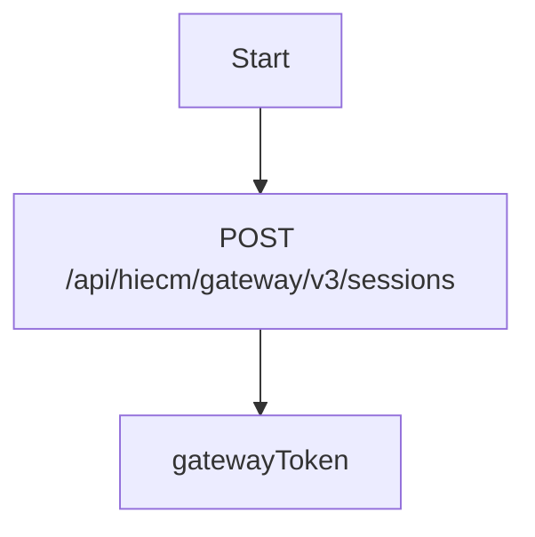
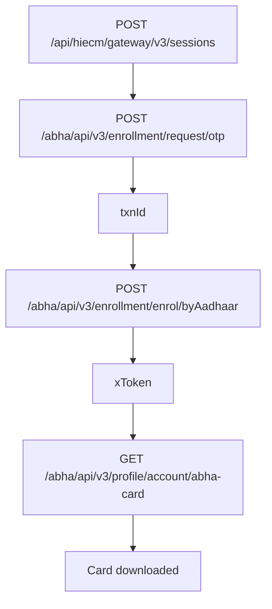
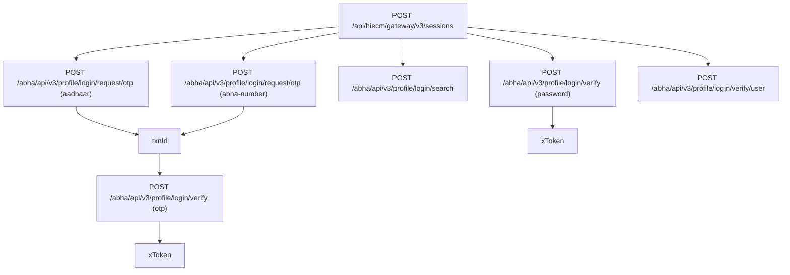
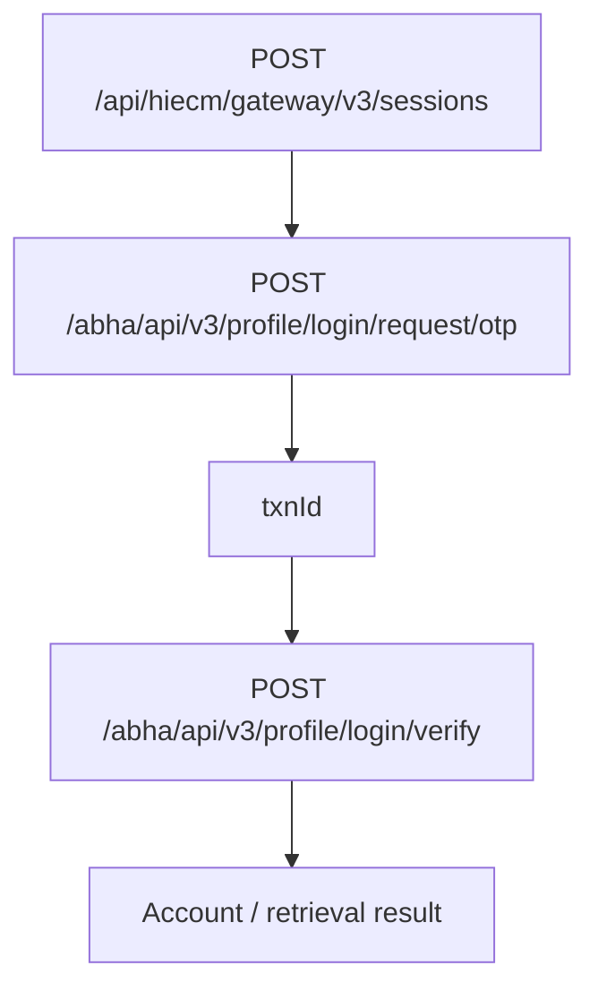
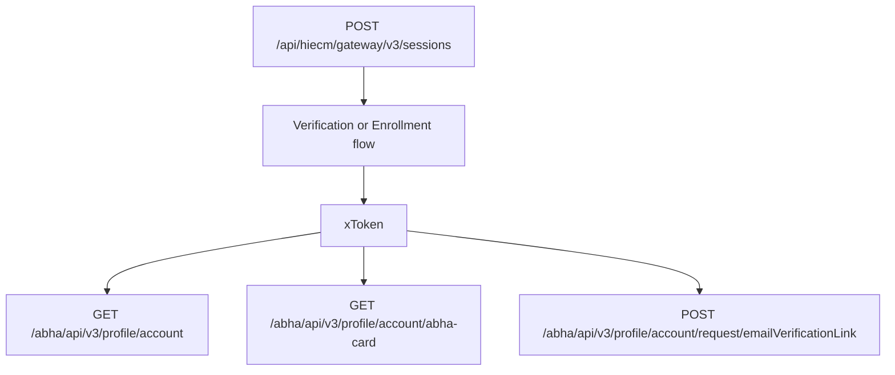
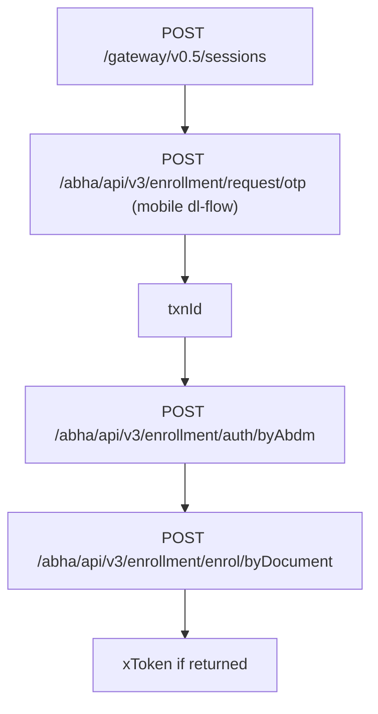
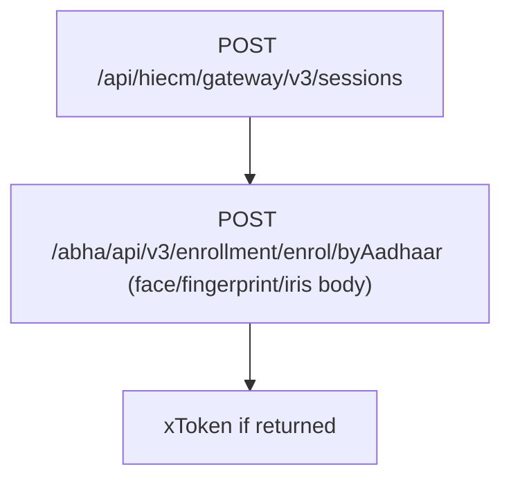
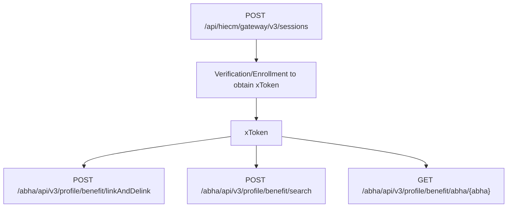
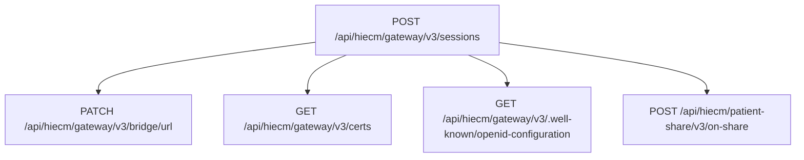
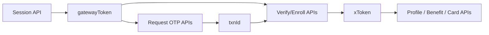

# ABDM Use Case Flow Diagrams

These diagrams show **what to call next** and the dependency tokens (`gatewayToken`, `txnId`, `xToken`) required between API calls.

---

## 1) Common Foundation (used by most flows)

---

## 2) Aadhaar Enrollment -> ABHA Card

Dependencies:
- `request/otp` needs encrypted Aadhaar + `gatewayToken`
- `enrol/byAadhaar` needs `txnId` + encrypted OTP + mobile + `gatewayToken`
- `abha-card` needs `gatewayToken` + `xToken`

---

## 3) Verification / Login Flows

Dependencies:
- OTP verify branch uses `txnId` from request-otp
- Password branch does not need OTP txn
- `verify/user` may require `T-token` in header depending on context

---

## 4) Forgot / Retrieval

Note: Same underlying APIs as verification OTP flow.

---

## 5) Profile Flows

Dependencies:
- Profile APIs are typically post-login/post-enroll operations requiring `xToken`

---

## 6) DL Enrollment Flow

Dependencies:
- `enrol/byDocument` body contains DL and identity details
- `auth/byAbdm` needs OTP + txn chain from request-otp

---

## 7) Biometric Enrollment

Dependencies:
- Requires API-spec compliant biometric payload/PID block

---

## 8) Benefit APIs

Dependencies:
- Usually requires authenticated profile context (`xToken`)

---

## 9) Scan and Share / Gateway Ops

Dependencies:
- Most gateway/bridge calls require gateway bearer token

---

## Token Dependency Quick View

